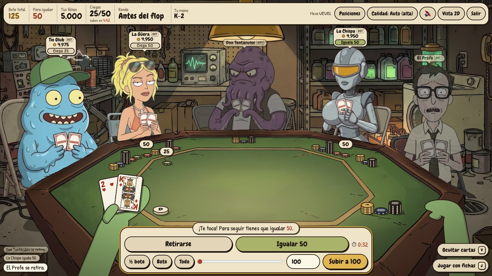
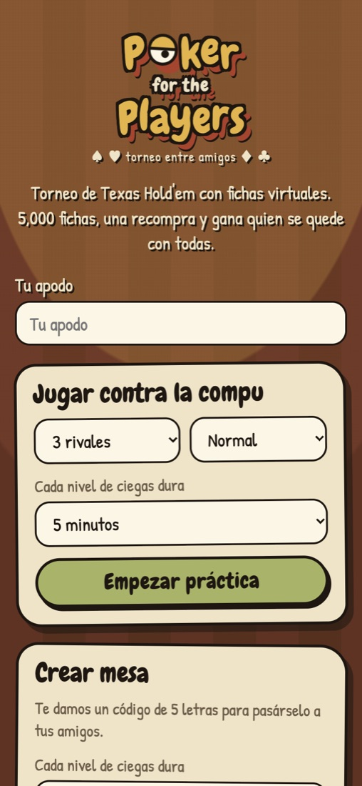
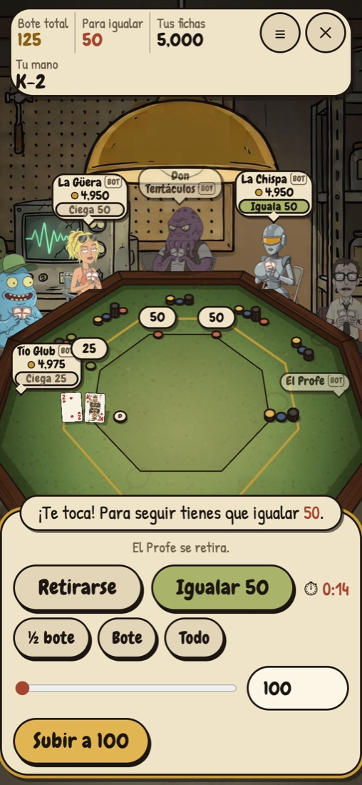
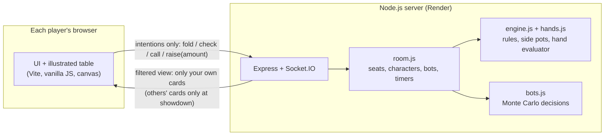

# Poker for the Players

A real-time multiplayer **Texas Hold'em No-Limit** tournament for a group of friends, playable from any phone or computer with a link. It uses virtual chips (no real money). You can also practice alone against bots.

I built it with **Claude Code** from written specs (`CLAUDE.md`). I wrote the specs, reviewed the work, tested every change and shipped it. Commits are co-authored with Claude.

> The UI and code comments are in Spanish (Mexico). The game is for a Spanish-speaking group of friends.



<p align="center">
  
  &nbsp;&nbsp;
  
</p>

## What it does

- **Private tables with a 5-letter code.** Share the table link on WhatsApp and friends join from their phones. Up to 6 seats per table.
- **Practice against bots** on three difficulty levels. The bots estimate their equity with Monte Carlo simulations (300 to 800 runs, depending on difficulty) using only what a player can see, then add noise, aggression and bluffing by level.
- **Full tournament rules.** 5,000 starting chips, one rebuy, rising blind levels, side pots, ties, all-ins and heads-up play.
- **Character selection.** Each player picks an illustrated character, and picking one is what seats you at the table.
- **Illustrated first-person table.** The table is a layered 2D scene, with blinking and breathing rivals and your own arms holding your cards on desktop. There's a separate layout for phones.

## Architecture

The main design problem: in the first prototype the full game state, including the deck, lived in a shared document, so anyone could read other players' cards with the browser's dev tools. In this version **the server is the only authority**.



- Only the server holds the deck and every player's cards.
- Each client gets a **filtered view**: its own cards, plus other players' cards only when they're revealed at showdown.
- Clients send only **intentions**. The server checks that it's your turn and that the move is legal.
- Tables live in server memory, so there's no database.

## Testing

`npm test` runs **123 tests in 13 suites** (Node's built-in test runner). They cover:

- the game engine (chip conservation, side pots, ties, all-in, heads-up), checked across thousands of simulated hands
- the hand evaluator, and bots that never see other players' cards
- seats and character selection, the server's filtered views, chips, layout and the card deck

## AI art pipeline

The characters, table and cards are AI illustrations, processed with my own Python scripts (`scripts/`):

- `generar-personaje.py`: edits an approved base drawing with Gemini **one zone at a time** (blink, bet, peek) instead of generating from scratch, so the character stays consistent. Each result is checked automatically, including macOS Vision OCR to reject images where the model drew stray text.
- `generar-baraja.py`: the card art. The model never draws letters, numbers or suits. The code adds the indices, suits and the logo label.
- `recortar.py` removes backgrounds (rembg), and `optimizar-arte.py` exports responsive WebP files.
- `calcar-mesa.py` traces the illustrated table so the game can project chips and cards with the same perspective.

## Tech stack

Node.js 24 · Express · Socket.IO · Vite · vanilla JavaScript + Canvas · Python (Pillow, rembg) · Gemini image API · Render (Blueprint in `render.yaml`)

## Run it locally

```sh
npm install
npm run dev     # http://localhost:3000 with live reload
npm test        # the test suite
npm run build && npm start   # production mode, as on Render
```

The deploy guide (in Spanish) is in [`docs/PUBLICAR.md`](docs/PUBLICAR.md).

---

Made by **Diego Lemus Reyna** · [lemusautomations.com](https://lemusautomations.com)
